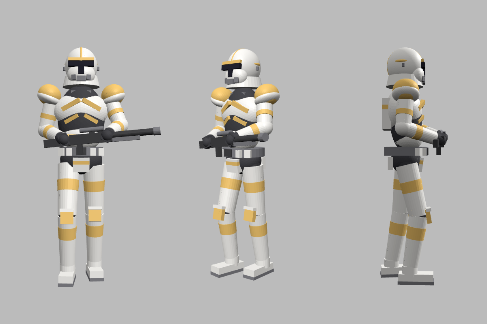

# Clone trooper – 212e bataillon (modèle 3D low-poly)

| Fichier | Usage |
|---|---|
| `clone_trooper_212.glb` | Format conseillé : couleurs incluses (Blender, Windows Visionneuse 3D, three.js, Unity, Godot…) |
| `clone_trooper_212.obj` + `.mtl` | Format universel avec couleurs simples |
| `clone_trooper_212.stl` | Impression 3D (une seule couleur) |
| `generate_clone.py` | Script qui régénère le modèle (`pip install trimesh numpy`) |

Unités : mètres (≈ 1,88 m), Y vers le haut, le personnage regarde vers +Z.
Modèle non riggé (pas de squelette), pose fixe fusil en main.
