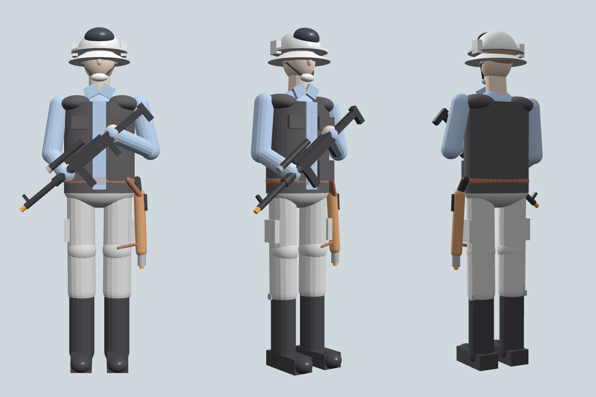

# Soldat rebelle – modèle 3D

Modèle 3D stylisé (low-poly, ~38 000 faces, hauteur 1,80 m) d'un soldat rebelle : casque blanc à visière, chemise bleue, gilet noir, pantalon cargo gris, bottes noires, ceinture et holster marron, fusil blaster et pistolet.

| Fichier | Usage |
|---|---|
| `rebel_trooper.glb` | Recommandé : couleurs incluses (Blender, Windows 3D Viewer, https://gltf-viewer.donmccurdy.com, etc.) |
| `rebel_trooper.obj` + `.mtl` | Format universel avec matériaux (garder les deux fichiers ensemble) |
| `rebel_trooper_figurine_mm.stl` | Impression 3D : figurine d'environ 18 cm, sans couleur |
| `build_model.py` | Script qui régénère les fichiers : `pip install trimesh scipy mapbox-earcut && python3 build_model.py` |
