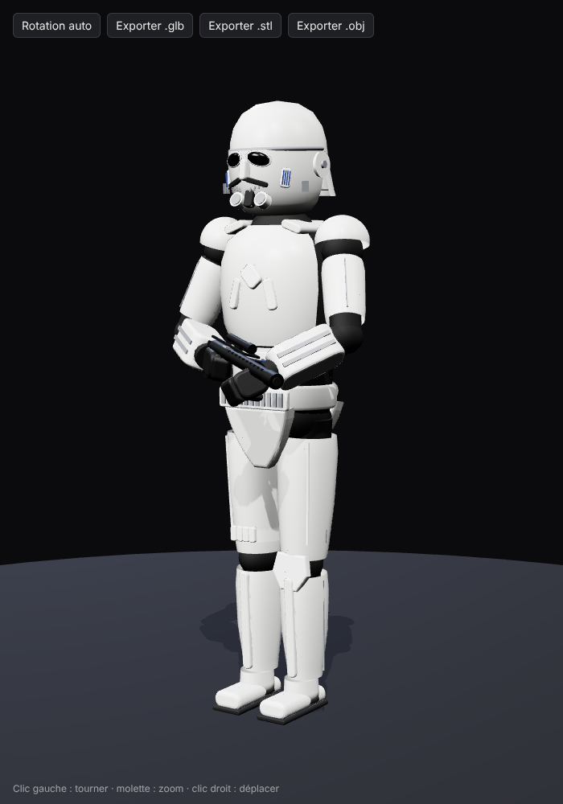

# Stormtrooper 3D

Modèle 3D procédural d'un stormtrooper (armure impériale + blaster E-11), réalisé avec Three.js d'après la photo de référence : même posture, blaster tenu en travers du corps.



## Fichiers

| Fichier | Rôle |
| --- | --- |
| `models/stormtrooper.glb` | Modèle avec matériaux (Blender, Windows 3D Viewer, sites web, Unity/Unreal) |
| `models/stormtrooper.obj` | Format universel (géométrie, groupes nommés par pièce) |
| `models/stormtrooper.stl` | Pour l'impression 3D (géométrie seule) |
| `stormtrooper.js` | Source du modèle (pièces nommées : `casque`, `plastron`, `bras_droit`, `blaster_E11`…) |
| `index.html` | Visionneuse interactive avec boutons d'export |
| `export.mjs` | Régénère les fichiers de `models/` |

Échelle : 1 unité = 1 mètre, hauteur ≈ 1,83 m, axe Y vers le haut, pieds à l'origine.

## Voir le modèle

```bash
cd stormtrooper
python3 -m http.server 8000   # puis ouvrir http://localhost:8000
```

Clic gauche pour tourner, molette pour zoomer, clic droit pour déplacer.

## Régénérer les exports après modification

```bash
cd stormtrooper
npm install
npm run export
```
